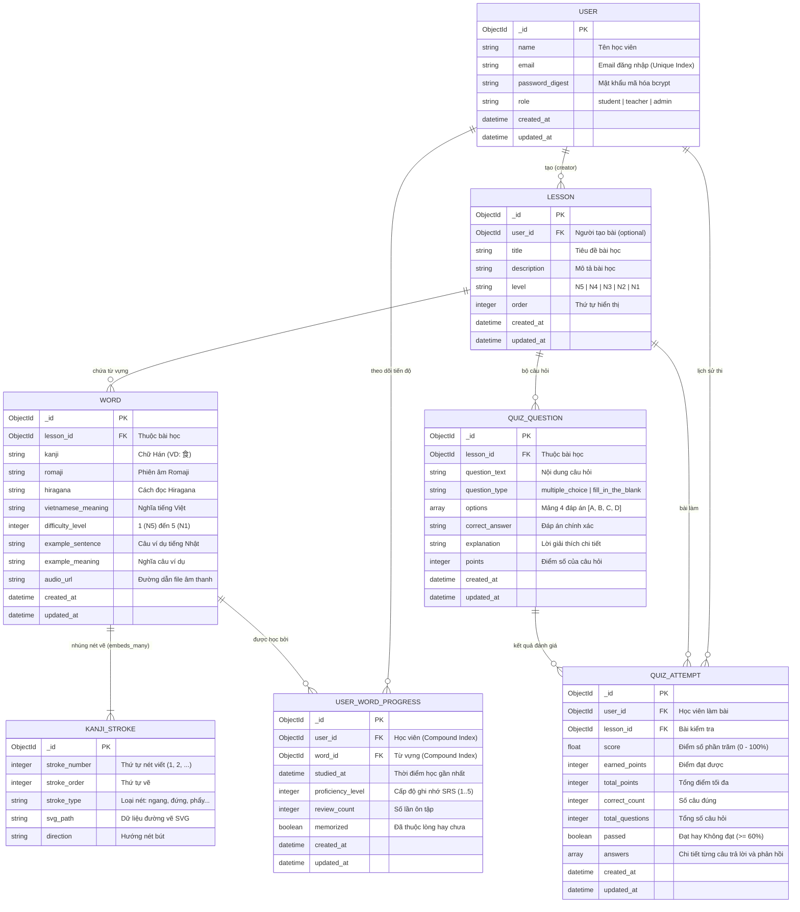
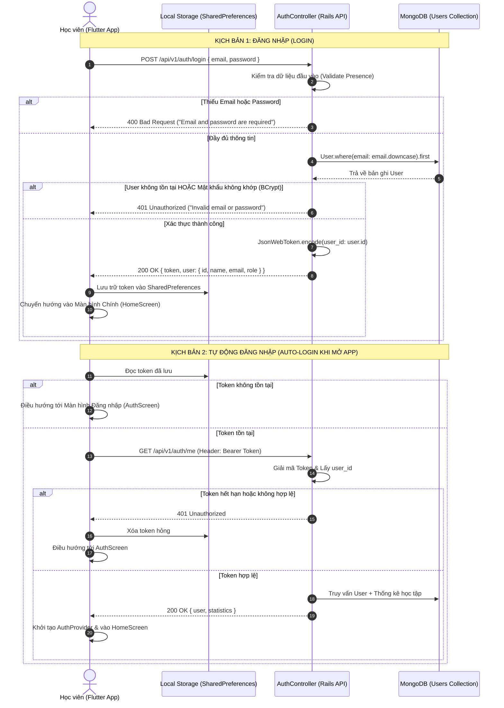
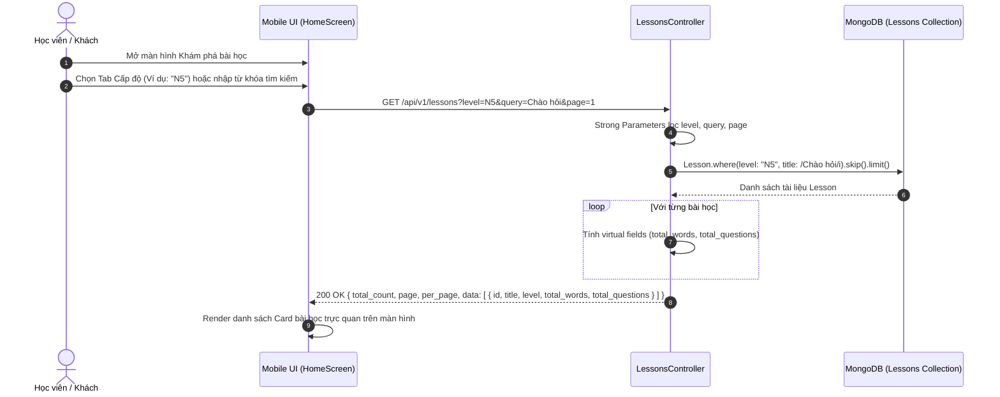
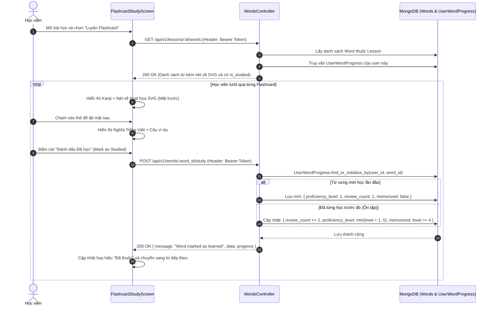
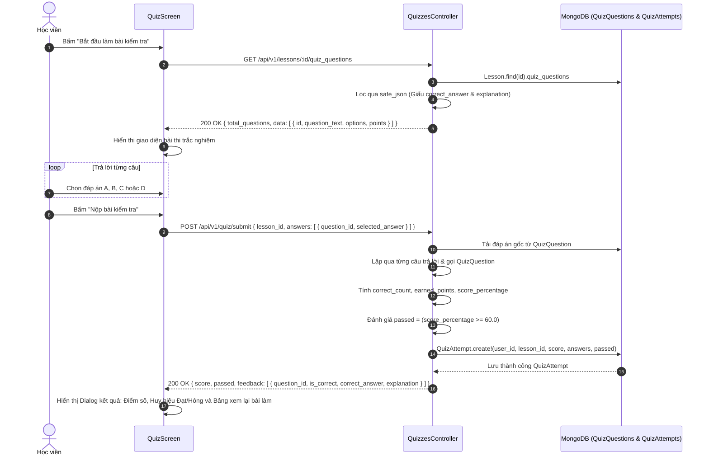
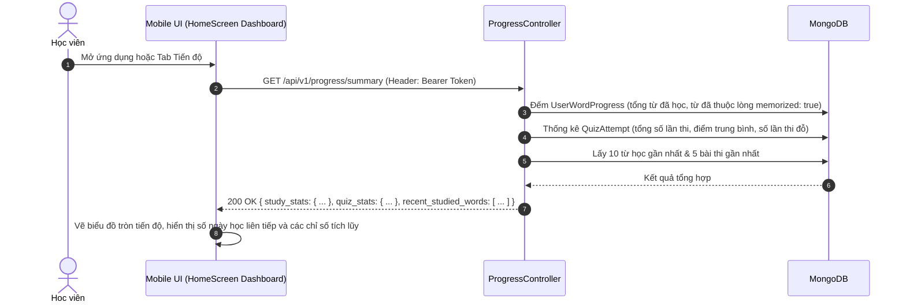

# TÀI LIỆU ĐẶC TẢ NGHIỆP VỤ HỆ THỐNG
## ỨNG DỤNG HỌC TIẾNG NHẬT (JAPANESE LEARNING APPLICATION)

---

## 1. TỔNG QUAN HỆ THỐNG & ĐỐI TƯỢNG SỬ DỤNG

### 1.1 Mục Tiêu Dự Án
Hệ thống hỗ trợ học tiếng Nhật toàn diện dành cho người học từ trình độ sơ cấp (N5) đến nâng cao (N1), kết hợp giữa học từ vựng trực quan (Flashcard, nét viết Kanji Stroke Canvas), phương pháp lặp lại ngắt quãng (**Spaced Repetition System - SRS**), kiểm tra trắc nghiệm chấm điểm tự động tức thì, và theo dõi tiến độ học tập theo thời gian thực.

### 1.2 Kiến Trúc Giải Pháp
- **Backend (API)**: Ruby on Rails 8 (API-only mode), MongoDB (Mongoid ODM 9.1), JWT Authentication, Swagger / OpenAPI 3.0.3.
- **Frontend (Mobile)**: Flutter (Dart), Provider State Management, SharedPreferences Token Storage, Canvas SVG Kanji Rendering.
- **Cơ sở dữ liệu**: MongoDB (NoSQL Document Store, tận dụng Embedded Documents cho nét viết Kanji và mảng lựa chọn câu hỏi).

### 1.3 Đối Tượng Người Dùng & Vai Trò (Actors & Roles)
1. **Khách (Guest / Unauthenticated User)**:
   - Xem danh sách bài học, tìm kiếm bài học, lọc theo cấp độ JLPT (N5 - N1).
   - Xem danh sách từ vựng cơ bản và nét viết Kanji của bài học công khai.
   - Làm đề thi thử (không lưu kết quả và tiến độ học vào cơ sở dữ liệu).
2. **Học viên (Student / Authenticated User)**:
   - Toàn bộ quyền của Khách.
   - Lưu trữ tiến độ học từng từ vựng, tự động nâng cấp độ ghi nhớ theo thuật toán SRS.
   - Thêm từ vựng/flashcard cá nhân vào bài học.
   - Làm bài kiểm tra, nộp bài, nhận phản hồi chấm điểm chi tiết và lưu lịch sử làm bài (`QuizAttempt`).
   - Xem Dashboard tiến độ học tập (tổng từ đã học, từ đã thuộc lòng, điểm trung bình).
3. **Giáo viên / Quản trị viên (Teacher / Admin)**:
   - Toàn bộ quyền của Học viên.
   - Tạo mới bài học, chỉnh sửa nội dung bài học, thiết lập bộ câu hỏi kiểm tra (`QuizQuestion`).

---

## 2. MÔ HÌNH DỮ LIỆU & ĐẶC TẢ THUỘC TÍNH (ATTRIBUTES SPECIFICATION)

### 2.1 Sơ Đồ Quan Hệ Thực Thể (Entity Relationship Diagram)

---

### 2.2 Bảng Chi Tiết Thuộc Tính (Data Dictionary)

#### Entity: `User` (Bộ sưu tập: `users`)
| Tên Thuộc Tính | Kiểu Dữ Liệu | Bắt Buộc | Ràng Buộc / Mô Tả | Mục Đích Nghiệp Vụ |
| :--- | :--- | :---: | :--- | :--- |
| `_id` | ObjectId | Có | Tự sinh (Primary Key) | Định danh duy nhất người dùng trong hệ thống. |
| `name` | String | Có | Độ dài 2 - 50 ký tự | Tên hiển thị của học viên/giảng viên. |
| `email` | String | Có | Định dạng Email, Unique Index, không phân biệt hoa thường | Tên tài khoản đăng nhập và nhận thông báo. |
| `password_digest` | String | Có | Mã hóa một chiều bằng BCrypt | Bảo mật mật khẩu truy cập. |
| `role` | String | Có | Giá trị: `student`, `teacher`, `admin`. Mặc định: `student` | Phân quyền truy cập các API quản trị nội dung. |
| `created_at` | DateTime | Có | Tự sinh khi tạo tài khoản | Ngày giờ đăng ký tài khoản. |
| `updated_at` | DateTime | Có | Tự sinh khi sửa thông tin | Ngày giờ cập nhật hồ sơ gần nhất. |

#### Entity: `Lesson` (Bộ sưu tập: `lessons`)
| Tên Thuộc Tính | Kiểu Dữ Liệu | Bắt Buộc | Ràng Buộc / Mô Tả | Mục Đích Nghiệp Vụ |
| :--- | :--- | :---: | :--- | :--- |
| `_id` | ObjectId | Có | Tự sinh (Primary Key) | Định danh duy nhất bài học. |
| `user_id` | ObjectId | Không | Tham chiếu `User._id` | Người khởi tạo bài học (Giáo viên/Admin). |
| `title` | String | Có | Không rỗng, Index tìm kiếm Text | Tiêu đề bài học (VD: "Bài 1: Giới thiệu bản thân"). |
| `description` | String | Không | Văn bản mô tả | Giới thiệu mục tiêu kiến thức đạt được sau bài học. |
| `level` | String | Có | Enum: `N5`, `N4`, `N3`, `N2`, `N1`. Index tìm kiếm | Phân loại cấp độ bài học theo chuẩn kỳ thi JLPT. |
| `order` | Integer | Có | Số nguyên dương, mặc định `1`. Index sắp xếp | Thứ tự xuất hiện trong lộ trình học. |
| `total_words` *(Virtual)* | Integer | Tự tính | Số lượng bản ghi `Word` thuộc bài học | Hiển thị số lượng từ cho học viên nắm quy mô bài học. |
| `total_questions` *(Virtual)* | Integer | Tự tính | Số lượng bản ghi `QuizQuestion` thuộc bài học | Hiển thị số lượng câu hỏi kiểm tra của bài học. |

#### Entity: `Word` (Bộ sưu tập: `words`)
| Tên Thuộc Tính | Kiểu Dữ Liệu | Bắt Buộc | Ràng Buộc / Mô Tả | Mục Đích Nghiệp Vụ |
| :--- | :--- | :---: | :--- | :--- |
| `_id` | ObjectId | Có | Tự sinh (Primary Key) | Định danh duy nhất từ vựng. |
| `lesson_id` | ObjectId | Không | Tham chiếu `Lesson._id`, Index | Thuộc bài học nào (cho phép từ vựng độc lập nếu cần). |
| `kanji` | String | Có | Ký tự chữ Hán / Kanji (VD: `食`, `日`) | Hiển thị mặt trước thẻ Flashcard và nhận diện nét viết. |
| `romaji` | String | Không | Phiên âm La-tinh (VD: `shoku / taberu`) | Hỗ trợ phát âm cho người mới bắt đầu. |
| `hiragana` | String | Không | Chữ viết Kana (VD: `たべる`) | Cách đọc chuẩn tiếng Nhật trong ngữ pháp. |
| `vietnamese_meaning` | String | Có | Văn bản dịch nghĩa tiếng Việt (Alias: `meaning`) | Nghĩa cốt lõi của từ khi lật mặt sau Flashcard. |
| `difficulty_level` | Integer | Có | Giá trị từ `1` (N5) đến `5` (N1). Mặc định: `1` | Phân cấp độ khó của từ vựng. |
| `example_sentence` | String | Không | Câu ví dụ tiếng Nhật (VD: `ご飯を食べます。`) | Giúp hiểu ngữ cảnh sử dụng thực tế. |
| `example_meaning` | String | Không | Dịch nghĩa tiếng Việt của câu ví dụ | Giúp ghi nhớ sâu hơn thông qua liên tưởng. |
| `audio_url` | String | Không | URL file MP3/AAC phát âm mẫu | Hỗ trợ luyện nghe và phát âm chuẩn. |
| `kanji_strokes` | Array | Không | Mảng Embedded Documents `KanjiStroke` | Chứa dữ liệu tọa độ các nét bút để Flutter vẽ mô phỏng. |

#### Embedded Entity: `KanjiStroke` (Nhúng trong `Word.kanji_strokes`)
| Tên Thuộc Tính | Kiểu Dữ Liệu | Bắt Buộc | Ràng Buộc / Mô Tả | Mục Đích Nghiệp Vụ |
| :--- | :--- | :---: | :--- | :--- |
| `_id` | ObjectId | Có | Tự sinh | Định danh duy nhất của nét viết. |
| `stroke_number` | Integer | Có | Số thứ tự nét (1, 2, 3...) | Xác định thứ tự hạ bút theo quy chuẩn Hán tự. |
| `stroke_order` | Integer | Không | Thứ tự hiển thị diễn hoạt | Điều khiển tốc độ và thứ tự render Canvas trên Flutter. |
| `stroke_type` | String | Không | `horizontal`, `vertical`, `slant_left`, `slant_right`... | Phân loại nét bút (nét ngang, sổ, phẩy, mác). |
| `svg_path` | String | Không | Chuỗi path d="..." chuẩn vector SVG | Vẽ đồ họa vector lên màn hình cảm ứng điện thoại. |
| `direction` | String | Không | `left_to_right`, `top_to_bottom`, `top_to_right`... | Chỉ dẫn hướng đưa bút cho học viên tập viết. |

#### Entity: `QuizQuestion` (Bộ sưu tập: `quiz_questions`)
| Tên Thuộc Tính | Kiểu Dữ Liệu | Bắt Buộc | Ràng Buộc / Mô Tả | Mục Đích Nghiệp Vụ |
| :--- | :--- | :---: | :--- | :--- |
| `_id` | ObjectId | Có | Tự sinh (Primary Key) | Định danh câu hỏi. |
| `lesson_id` | ObjectId | Có | Tham chiếu `Lesson._id`, Index | Thuộc bài học tương ứng. |
| `question_text` | String | Có | Văn bản câu hỏi (VD: "Từ '人' có nghĩa là gì?") | Nội dung hiển thị trên giao diện làm bài thi. |
| `question_type` | String | Có | `multiple_choice`, `fill_in_the_blank`. Mặc định: `multiple_choice` | Định dạng giao diện câu hỏi trên Mobile. |
| `options` | Array | Có | Mảng 4 chuỗi: `["A. ...", "B. ...", "C. ...", "D. ..."]` | Các phương án lựa chọn cho học viên. |
| `correct_answer` | String | Có | Khóa đáp án đúng: `"A"`, `"B"` hoặc nội dung | Đáp án đối chiếu khi chấm điểm (được bảo mật). |
| `explanation` | String | Không | Văn bản giải thích lý do vì sao đáp án đúng | Cung cấp feedback sửa sai ngay sau khi nộp bài. |
| `points` | Integer | Có | Mặc định `10` điểm | Điểm tối đa khi trả lời đúng câu này. |

#### Entity: `UserWordProgress` (Bộ sưu tập: `user_word_progresses`)
| Tên Thuộc Tính | Kiểu Dữ Liệu | Bắt Buộc | Ràng Buộc / Mô Tả | Mục Đích Nghiệp Vụ |
| :--- | :--- | :---: | :--- | :--- |
| `_id` | ObjectId | Có | Tự sinh (Primary Key) | Định danh bản ghi tiến độ. |
| `user_id` | ObjectId | Có | Tham chiếu `User._id`, Compound Unique Index | Học viên nào đang học. |
| `word_id` | ObjectId | Có | Tham chiếu `Word._id`, Compound Unique Index | Từ vựng đang được theo dõi. |
| `studied_at` | DateTime | Có | Mặc định: Thời gian hiện tại | Lần ôn tập gần nhất để tính chu kỳ lặp lại tiếp theo. |
| `proficiency_level` | Integer | Có | Khoảng giá trị `1` đến `5`. Mặc định: `1` | Mức độ thuần thục theo thuật toán SRS (Level 1..5). |
| `review_count` | Integer | Có | Tăng dần (+1 sau mỗi lần ôn). Mặc định: `1` | Tổng số lần học viên đã tương tác với từ vựng. |
| `memorized` | Boolean | Có | Mặc định: `false`. Tự động `true` khi Level >= 4 | Đánh dấu học viên đã hoàn toàn thuộc lòng từ này. |

#### Entity: `QuizAttempt` (Bộ sưu tập: `quiz_attempts`)
| Tên Thuộc Tính | Kiểu Dữ Liệu | Bắt Buộc | Ràng Buộc / Mô Tả | Mục Đích Nghiệp Vụ |
| :--- | :--- | :---: | :--- | :--- |
| `_id` | ObjectId | Có | Tự sinh (Primary Key) | Định danh lần nộp bài kiểm tra. |
| `user_id` | ObjectId | Có | Tham chiếu `User._id`, Index | Học viên thực hiện bài kiểm tra. |
| `lesson_id` | ObjectId | Có | Tham chiếu `Lesson._id`, Index | Bài học được kiểm tra. |
| `score` | Float | Có | Giá trị từ `0.0` đến `100.0` | Tỷ lệ phần trăm làm đúng của bài thi. |
| `earned_points` | Integer | Có | Tổng điểm câu đúng đạt được | Điểm tích lũy phục vụ tính xếp hạng. |
| `total_points` | Integer | Có | Tổng điểm trọn vẹn của đề thi | Thang điểm cơ sở. |
| `correct_count` | Integer | Có | Số câu trả lời đúng | Thống kê số lượng kết quả. |
| `total_questions` | Integer | Có | Tổng số câu hỏi của đề thi | Thống kê quy mô đề thi. |
| `passed` | Boolean | Có | `true` nếu `score >= 60.0%`, ngược lại `false` | Tiêu chí đạt chuẩn qua bài học. |
| `answers` | Array | Có | Mảng chi tiết từng câu (chọn gì, đúng/sai, giải thích) | Lưu vết phục vụ xem lại lịch sử chi tiết. |

---

## 3. CÁC LUỒNG NGHIỆP VỤ CỐT LÕI (CORE BUSINESS WORKFLOWS)

### 3.1 Luồng Nghiệp Vụ 1: Xác Thực & Đăng Nhập Tài Khoản (Authentication Workflow)

#### Mô Tả Nghiệp Vụ:
- Cho phép người dùng đăng ký tài khoản học tập với họ tên, email và mật khẩu.
- Cho phép đăng nhập để lấy mã truy cập an toàn (JWT Token).
- Tự động ghi nhớ phiên đăng nhập trên thiết bị di động (SharedPreferences). Khi mở app, hệ thống tự động kiểm tra token hợp lệ để vào thẳng màn hình chính (`Home`).

---

### 3.2 Luồng Nghiệp Vụ 2: Quản Lý & Khám Phá Bài Học (Lesson Management Workflow)

#### Mô Tả Nghiệp Vụ:
- Học viên duyệt danh sách bài học theo lộ trình chuẩn JLPT (N5 -> N1).
- Hỗ trợ bộ lọc cấp độ (`level`), tìm kiếm từ khóa theo tiêu đề (`query`), và phân trang dữ liệu (`page`, `per_page`).
- Mỗi bài học phản hồi số lượng từ vựng (`total_words`) và số câu hỏi trắc nghiệm (`total_questions`).

---

### 3.3 Luồng Nghiệp Vụ 3: Học Từ Vựng Flashcard & Nét Vẽ Kanji (SRS Flashcard Study Workflow)

#### Mô Tả Nghiệp Vụ:
- Khi chọn 1 bài học, học viên xem toàn bộ từ vựng thuộc bài đó.
- Nếu học viên đã đăng nhập, hệ thống tự động kiểm tra bảng `UserWordProgress` và đánh dấu cờ `is_studied: true/false` cho từng từ.
- Học viên chuyển sang màn hình **Flashcard**:
  - **Mặt trước thẻ**: Hiển thị Chữ Hán (Kanji), Romaji, Hiragana và Canvas mô phỏng thứ tự các nét viết Kanji (`KanjiStroke`).
  - **Mặt sau thẻ**: Hiển thị Nghĩa tiếng Việt, ví dụ câu tiếng Nhật và dịch nghĩa.
- Học viên bấm nút **"Đã nhớ" / "Học xong"**:
  - Gửi yêu cầu `POST /api/v1/words/:id/study`.
  - Backend cập nhật thuật toán Spaced Repetition (SRS):
    - Tăng số lần ôn tập (`review_count = review_count + 1`).
    - Nâng cấp độ thuần thục (`proficiency_level = min(level + 1, 5)`).
    - Nếu `proficiency_level >= 4` ➔ Đánh dấu `memorized = true`.
- Học viên có thể mở `AddWordBottomSheet` để tự thêm từ vựng mới vào bài học.

---

### 3.4 Luồng Nghiệp Vụ 4: Làm Bài Kiểm Tra & Chấm Điểm Tức Thì (Quiz & Instant Grading Workflow)

#### Mô Tả Nghiệp Vụ:
- Đảm bảo tính bảo mật của kỳ thi: Khi tải đề thi, backend **tuyệt đối không để lộ đáp án đúng** (`correct_answer`) và lời giải thích (`explanation`).
- Học viên hoàn thành tất cả câu hỏi và nhấn **Nộp bài** (`Submit Quiz`).
- Backend tự động chấm điểm độc lập:
  - So khớp thông minh: Hỗ trợ khớp cả ký tự lựa chọn (`"A"`, `"B"`), chuỗi nguyên bản (`"A. Người"`), hoặc nội dung văn bản (`"Người"`).
  - Tính toán tổng điểm đạt được (`earned_points`) và tỷ lệ phần trăm (`score = correct_count / total * 100`).
  - Đánh giá tiêu chuẩn: `passed = (score >= 60.0%)`.
  - Lưu bản ghi lịch sử `QuizAttempt`.
- Trả về kết quả chấm điểm tức thì và bảng đối chiếu chi tiết kèm lời giải thích cho từng câu hỏi.

---

### 3.5 Luồng Nghiệp Vụ 5: Thống Kê & Báo Cáo Tiến Độ (Progress Dashboard Workflow)

#### Mô Tả Nghiệp Vụ:
- Cung cấp cái nhìn tổng quan về quá trình học tập của học viên.
- Phục vụ việc hiển thị các widget thống kê trên Màn hình chính (`HomeScreen`).

---

## 4. QUY TẮC NGHIỆP VỤ & RÀNG BUỘC HỆ THỐNG (BUSINESS RULES & CONSTRAINTS)

### 4.1 Quy Tắc Xác Thực & Phân Quyền
1. **BR-AUTH-01 (Mật khẩu an toàn)**: Mật khẩu người dùng phải có độ dài tối thiểu 6 ký tự, mã hóa 1 chiều bằng thuật toán BCrypt trước khi lưu vào MongoDB.
2. **BR-AUTH-02 (Thời hạn Token)**: JSON Web Token có thời hạn 7 ngày kể từ thời điểm phát hành. Khi token hết hạn, client phải điều hướng về màn hình đăng nhập.
3. **BR-AUTH-03 (Bảo vệ Endpoint)**: Các endpoint liên quan đến ghi nhận tiến độ (`/study`), nộp bài thi (`/quiz/submit`), xem lịch sử (`/quiz/history`), xem thống kê (`/progress/summary`) bắt buộc phải có header `Authorization: Bearer <token>`.

### 4.2 Quy Tắc Học Tập & Thuật Toán Spaced Repetition (SRS)
1. **BR-SRS-01 (Thang đo thuần thục)**: Thuộc tính `proficiency_level` của từ vựng nhận giá trị nguyên từ `1` đến `5`.
2. **BR-SRS-02 (Tăng bậc ôn tập)**:
   - Khi học lần đầu: `proficiency_level = 1`, `review_count = 1`, `memorized = false`.
   - Mỗi lần ôn tập lại: `review_count = review_count + 1`, `proficiency_level = min(current_level + 1, 5)`.
3. **BR-SRS-03 (Tiêu chuẩn thuộc lòng)**: Khi `proficiency_level >= 4`, thuộc tính `memorized` tự động chuyển sang `true`, đánh dấu từ vựng đã được khắc sâu vào trí nhớ dài hạn.

### 4.3 Quy Tắc Kiểm Tra & Đánh Giá Điểm Số
1. **BR-QUIZ-01 (Bảo mật đề thi)**: Endpoint lấy danh sách câu hỏi (`GET /api/v1/lessons/:id/quiz_questions`) phải loại bỏ trường `correct_answer` và `explanation` bằng phương thức `safe_json` để chống hành vi gian lận / inspect request trên thiết bị.
2. **BR-QUIZ-02 (Đối chiếu đáp án thông minh)**: Phương thức `QuizQuestion#check_answer` chấp nhận:
   - Khớp chính xác ký tự lựa chọn (VD: Học viên chọn `"C"`, đáp án là `"C"`).
   - Khớp nội dung tiền tố (VD: Học viên gửi `"C. Người"`, hoặc chỉ gửi `"Người"`).
   - Tự động bỏ qua khoảng trắng thừa và không phân biệt chữ hoa/thường.
3. **BR-QUIZ-03 (Tiêu chuẩn Đạt/Không đạt)**:
   - Điểm số được tính bằng công thức: $\text{Score} = \left(\frac{\text{Số câu đúng}}{\text{Tổng số câu hỏi}}\right) \times 100\%$.
   - Tiêu chí Đạt (`passed = true`) khi $\text{Score} \ge 60.0\%$.

---

## 5. MA TRẬN PHÂN QUYỀN & ÁNH XẠ ENDPOINT API (API MAPPING)

| STT | Phương Thức | Endpoint URI | Mô Tả Nghiệp Vụ | Vai Trò Cho Phép | Màn Hình Mobile Tương Ứng |
| :---: | :---: | :--- | :--- | :---: | :--- |
| 1 | `POST` | `/api/v1/auth/register` | Đăng ký tài khoản học viên mới | Public | `AuthScreen` (Tab Đăng ký) |
| 2 | `POST` | `/api/v1/auth/login` | Đăng nhập lấy Bearer JWT Token | Public | `AuthScreen` (Tab Đăng nhập) |
| 3 | `GET` | `/api/v1/auth/me` | Lấy hồ sơ cá nhân & số liệu học tập | Student, Admin | `HomeScreen` (Hồ sơ người dùng) |
| 4 | `GET` | `/api/v1/lessons` | Danh sách bài học (lọc level, query) | Public | `HomeScreen` (Tab Bài học) |
| 5 | `POST` | `/api/v1/lessons` | Tạo bài học mới | Teacher, Admin | `AddLessonDialog` |
| 6 | `GET` | `/api/v1/lessons/:id` | Chi tiết bài học | Public | `LessonDetailScreen` |
| 7 | `GET` | `/api/v1/lessons/:id/words` | Lấy từ vựng của bài (gắn cờ is_studied) | Public / Student | `FlashcardStudyScreen` |
| 8 | `GET` | `/api/v1/lessons/:id/quiz_questions` | Lấy đề thi kiểm tra (ẩn đáp án) | Public / Student | `QuizScreen` |
| 9 | `GET` | `/api/v1/words/:id` | Chi tiết từ vựng kèm nét viết Kanji | Public / Student | `WordDetailDialog` |
| 10 | `POST` | `/api/v1/words` | Tạo từ vựng / Flashcard mới | Student, Admin | `AddWordBottomSheet` |
| 11 | `POST` | `/api/v1/words/:id/study` | Ghi nhận tiến độ học từ vựng (SRS) | Student, Admin | `FlashcardStudyScreen` |
| 12 | `POST` | `/api/v1/quiz/submit` | Nộp bài thi, chấm điểm, lưu lịch sử | Student, Admin | `QuizResultDialog` |
| 13 | `GET` | `/api/v1/quiz/history` | Xem lịch sử các lần thi trước | Student, Admin | `QuizHistoryScreen` |
| 14 | `GET` | `/api/v1/quiz/attempts/:id` | Xem lại chi tiết 1 bài thi | Student, Admin | `QuizAttemptDetailScreen` |
| 15 | `GET` | `/api/v1/progress/summary` | Dashboard thống kê toàn diện | Student, Admin | `HomeScreen` (Dashboard Widget) |
